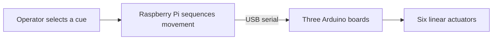

# Susan the Hexapod

Susan is a six-legged robot adapted for **Kinematic / Kinesthetic**, a May 2025 production by AXIS Dance Company led by artist Ben Levine. This repository preserves the original ROS and Arduino walking system and documents Kadir Uyanik’s work to get Susan moving again and ready for live choreography.

[Watch the robot adaptation and performance](https://vimeo.com/kadiru/hexapod-with-dancers) · [AXIS production and credits](https://axisdance.org/kinematic/)

## What changed for the stage

1. **Restore actuator control.** Susan arrived with disconnected wires and no wiring diagram. Kadir traced the actuator wiring against the controller pin assignments, made a wiring map, and restored movement.
2. **Put the load on wheels.** Two legs had broken during earlier tests under the robot’s own weight. The chassis was adapted to ride on a wheeled base, so the platform carried the load and the powered legs could move above the floor. The dancers could move the platform as part of the piece.
3. **Rebuild the control software.** A Raspberry Pi sequences the motions and sends timed serial commands to three Arduino boards. Each board drives a pair of linear actuators. The new firmware supports extension and retraction, speed, and gradual starts and stops.
4. **Make movements playable as cues.** Nadia Adame’s rehearsal notes and work with the AXIS team shaped the wave, shimmy, and extension sequences. By the first show, the repertoire had grown from one walking gait to about 15 stage movements. The operator could select a cue, interrupt its sequence, or ask the legs to retract. The team tested movements remotely with a studio camera; Kadir also prototyped extensions to make the short leg movements visible from the audience.

Susan performed at the Exploratorium on May 8 and 10 and at Stanford Live on May 21: four performances at two venues.

## How the performance controls fit together

The stage control scripts use Python and pySerial; the menu uses `curses`. A cue combines movements with duration, speed and ramp settings. Interruption stops the rest of the software sequence; an actuator command already sent is timed by the firmware.

## What’s in this repository

| Path | What to look for |
| --- | --- |
| [`arduino/`](arduino/) | The `*_leg_control_script` sketches for the original walking system and the `*_linear_actuator_control` sketches for timed performance movements. |
| [`interactive_menu.py`](catkin_ws/src/motor_control/scripts/interactive_menu.py) and [`behavior_manager.py`](catkin_ws/src/motor_control/scripts/behavior_manager.py) | Terminal cue selection, playback, interruption, and retraction. |
| [`behaviors.py`](catkin_ws/src/motor_control/scripts/behaviors.py) | The motion library: waves, shimmies, synchronized extensions, and timed sequences with different presets. |
| [`choreo_final.py`](catkin_ws/src/motor_control/scripts/choreo_final.py) | A standalone stage controller with manual behavior IDs and keyboard playback. |
| [`catkin_ws/`](catkin_ws/) and [original walking instructions](instructions_to_run_walking_robot.txt) | The inherited ROS 1 joystick and motor-control workflow. The performance scripts live inside this tree but send serial commands directly. |
| [Motor assignments](instructions_motor_arduino_connections.txt) and [stepper wiring notes](instructions_to_wire_stepper_motor_drivers.txt) | The board-to-leg mapping and reference notes for the original hardware. |

Start with `interactive_menu.py` and `behaviors.py` to trace a stage cue from selection to motor command. The scripts open hardware-specific serial devices, and the walking and performance sketches use different command formats. Check the firmware and board mapping before connecting a rebuilt unit.

## Credits

- **Original hexapod development:** engineering students at Carnegie Mellon University and the University of Maryland working with Ben Levine.
- **Production:** AXIS Dance Company; Ben Levine, lead artist; Nadia Adame, artistic director; AXIS dancers and rehearsal team.
- **Stage adaptation:** Kadir Uyanik, robotics engineering, robot choreography, and live teleoperation.
