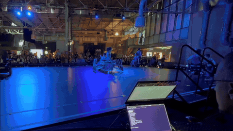
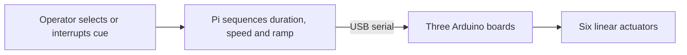

# A robot becomes a dance partner.

**Susan the Hexapod** was adapted for *Kinematic / Kinesthetic*, AXIS Dance Company's May 2025 production led by artist Ben Levine. The engineering goal was practical: restore a damaged robot and make its movements reliable, readable and playable as live performance cues.

*Real stage footage from the owner's performance film; the excerpt is cropped and plays at its original speed. Susan rides on a wheeled base moved by the dancers. This is choreographed, operator-cued motion.*

[Watch the adaptation and performance](https://vimeo.com/kadiru/hexapod-with-dancers) · [AXIS production credits](https://axisdance.org/kinematic/)

## From damaged hardware to stage cues

Kadir traced disconnected actuator wiring, documented the board-to-leg mapping, restored movement, rewrote the Arduino performance firmware, and built Raspberry Pi cue controls. A wheeled base carried the robot's weight so its powered legs could move above the floor.

Rehearsals with Nadia Adame and the AXIS team shaped waves, shimmies and extensions. The repertoire grew from one walking gait to about 15 stage movements by the first show. Susan appeared in **four performances at the Exploratorium and Stanford Live**. [Adaptation notes and dates](docs/STAGE_GUIDE.md#what-changed-for-the-stage)

## The central idea

The software makes a movement selectable and repeatable. Interrupting a sequence stops future cue commands; a command already sent still follows its firmware timing. Original walking firmware and stage firmware use different command formats.

## Read the code

| Follow a cue | Entry point |
| --- | --- |
| Selection and playback | [Interactive menu](catkin_ws/src/motor_control/scripts/interactive_menu.py) · [Behavior manager](catkin_ws/src/motor_control/scripts/behavior_manager.py) |
| Movement vocabulary | [Motion library](catkin_ws/src/motor_control/scripts/behaviors.py) |
| Standalone stage controller | [Final choreography controller](catkin_ws/src/motor_control/scripts/choreo_final.py) |
| Timed actuator control | [Arduino sketches](arduino/) · [Motor assignments](instructions_motor_arduino_connections.txt) |

For review, trace one behavior from the menu through the motion library to a serial command. Running the scripts opens hardware-specific serial devices. Rebuilding the system requires the correct board mapping and matching firmware; the [stage guide](docs/STAGE_GUIDE.md) retains the original walking and wiring references.

## Credits and future work

Original hexapod: engineering students at Carnegie Mellon University and the University of Maryland, working with Ben Levine. Production: AXIS Dance Company; Ben Levine, lead artist; Nadia Adame, artistic director; dancers and rehearsal team. **Kadir Uyanik:** stage adaptation, robotics engineering, robot choreography and live teleoperation.

This is a completed performance archive. A future revival would begin by revalidating the mechanical setup, firmware protocol and cue interruption behavior before rehearsals.
